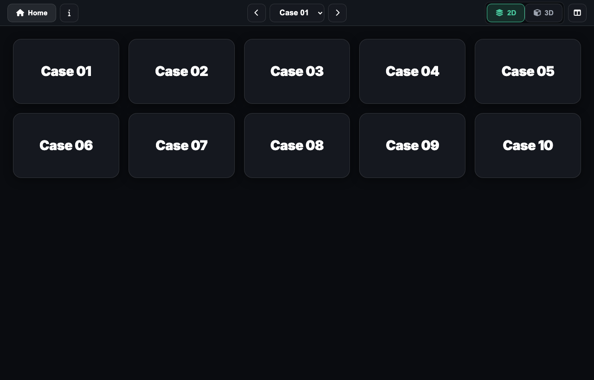
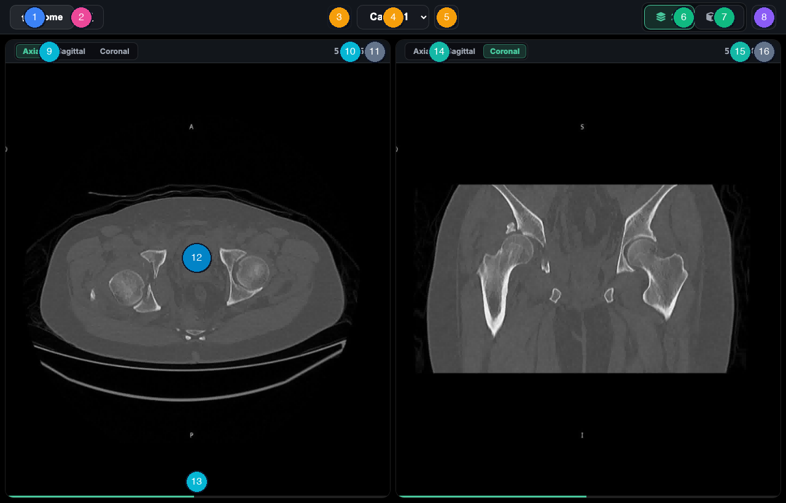
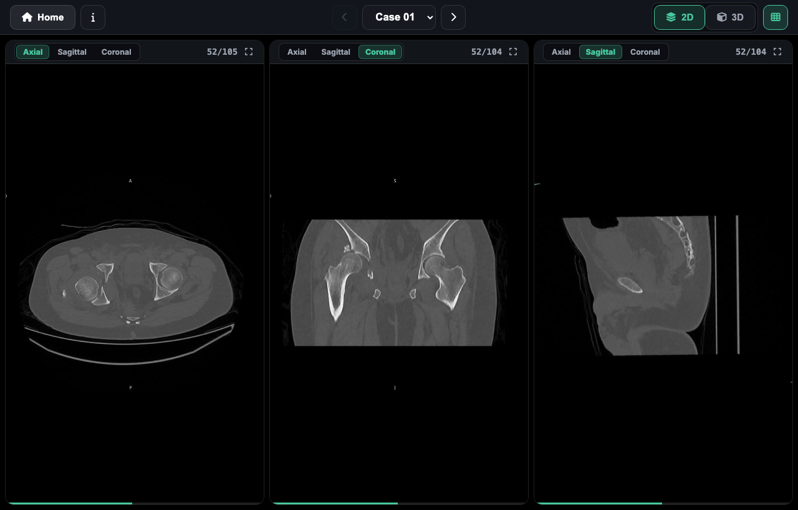
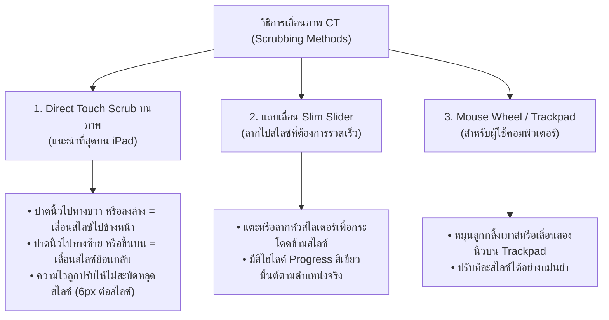
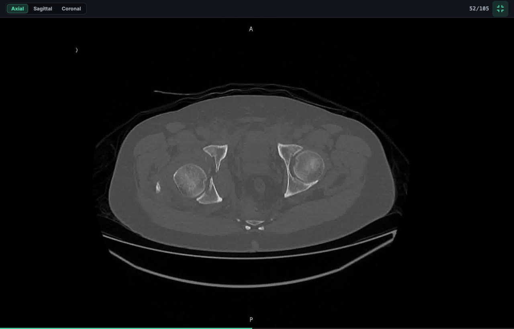
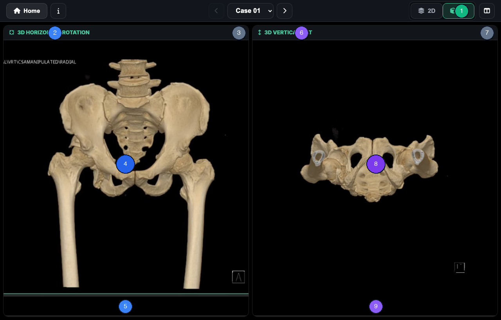
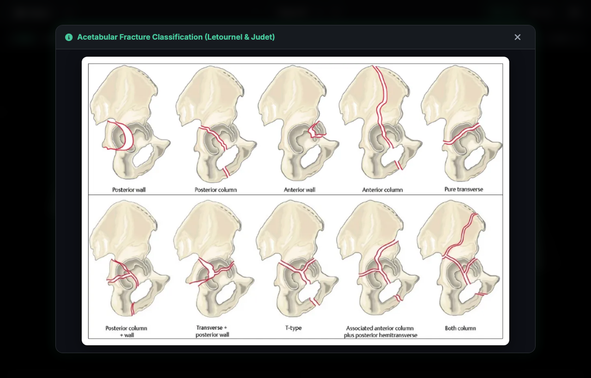

# คู่มือการใช้งานระบบ AcetaView สำหรับผู้เข้าร่วมการทดสอบและวิจัย
## (AcetaView Clinical Participant & Examiner User Manual)

เอกสารฉบับนี้เป็นคู่มือทางการสำหรับแพทย์ผู้ประเมินและผู้เข้าร่วมงานวิจัย (Participants / Examiners) ในการใช้งานเว็บแอปพลิเคชัน **AcetaView** เพื่อประเมินและวินิจฉัยภาพรังสีส่วนตัดอาศัยคอมพิวเตอร์ (CT Scans) ของผู้ป่วยกระดูกเบ้าสะโพกหัก (Acetabular Fractures) ทั้งในรูปแบบ 2D Multi-Planar Reconstruction (MPR) และ 3D Volume Reconstruction

---

## สารบัญ (Table of Contents)
1. [ข้อกำหนดระบบและการเตรียมอุปกรณ์ (System Requirements)](#1-ข้อกำหนดระบบและการเตรียมอุปกรณ์-system-requirements)
2. [หน้าหลักและการเลือกเคสวิจัย (Home Screen & Case Selection)](#2-หน้าหลักและการเลือกเคสวิจัย-home-screen--case-selection)
3. [แถบควบคุมหลักส่วนหัว (PACS Header Navigation)](#3-แถบควบคุมหลักส่วนหัว-pacs-header-navigation)
4. [การใช้งานมุมมอง 2D Multi-Planar Reconstruction (MPR)](#4-การใช้งานมุมมอง-2d-multi-planar-reconstruction-mpr)
5. [เทคนิคการเลื่อนภาพ (Touch Scrubbing & Slider Controls)](#5-เทคนิคการเลื่อนภาพ-touch-scrubbing--slider-controls)
6. [การขยายภาพเดี่ยวแบบเต็มจอ (Fullscreen Inspection)](#6-การขยายภาพเดี่ยวแบบเต็มจอ-fullscreen-inspection)
7. [การใช้งานมุมมอง 3D Volume Reconstruction](#7-การใช้งานมุมมอง-3d-volume-reconstruction)
8. [การเปิดแผ่นอ้างอิง Judet & Letournel Classification](#8-การเปิดแผ่นอ้างอิง-judet--letournel-classification)
9. [สรุปตารางปุ่มลัดและคำสั่งควบคุม (Quick Control Reference)](#9-สรุปตารางปุ่มลัดและคำสั่งควบคุม-quick-control-reference)

---

## 1. ข้อกำหนดระบบและการเตรียมอุปกรณ์ (System Requirements)

* **อุปกรณ์ที่แนะนำ:** iPad (หน้าจอ 10.2 นิ้วขึ้นไป) หรือแท็บเล็ตระบบสัมผัส, หรือคอมพิวเตอร์ Desktop/Laptop
* **เว็บเบราว์เซอร์ที่รองรับ:** Safari (แนะนำที่สุดสำหรับ iPad), Google Chrome, Microsoft Edge
* **การเชื่อมต่อเครือข่าย:** 
  * สำหรับการทดสอบในห้องสอบ/ห้องสัมมนา: เชื่อมต่อสัญญาณ Wi-Fi ประจำห้องสอบ แล้วเปิด URL ที่ผู้คุมสอบแจ้ง เช่น `http://192.168.1.XX:8080`
  * สำหรับการทดสอบออนไลน์: เข้าผ่าน URL `https://acetaview.pages.dev`
* **คำแนะนำเพิ่มเติม:** เพื่อประสบการณ์การอ่านภาพที่ดีที่สุด ควรปรับความสว่างหน้าจอ iPad ให้อยู่ในระดับที่เหมาะสม และถือเครื่องในแนวนอน (Landscape Orientation)

---

## 2. หน้าหลักและการเลือกเคสวิจัย (Home Screen & Case Selection)

เมื่อเข้าสู่ระบบ AcetaView หน้าแรกจะแสดง **Case Selector Grid** ประกอบด้วยการ์ดเคสวิจัย 10 เคส (Case 01 ถึง Case 10)

### ขั้นตอนการเลือกเคส:
1. แตะ (Tap) หรือคลิกที่การ์ด **Case 01 – Case 10** เพื่อเปิดเข้าสู่พื้นที่อ่านภาพ (Workspace) ของเคสนั้นทันที
2. ระบบจะโหลดภาพ 20 สไลซ์แรกขึ้นมาแสดงผลโดยทันที พร้อมเริ่มทยอยโหลดสไลซ์ที่เหลือไว้ใน Background Cache โดยอัตโนมัติ

---

## 3. แถบควบคุมหลักส่วนหัว (PACS Header Navigation)

แถบเมนูด้านบนสุดได้รับการออกแบบตามมาตรฐาน Medical PACS Display ช่วยให้ผู้ประเมินสามารถสลับเคส เปลี่ยนโหมด และปรับมุมมองได้อย่างรวดเร็ว

### ตารางระบุตำแหน่งปุ่มและหน้าที่การทำงาน (Header Callout Map)

| หมายเลขบนรูป | ชื่อปุ่ม / องค์ประกอบ | สัญลักษณ์ / ตัวอย่าง | หน้าที่และรายละเอียดการใช้งาน |
|:---:|:---|:---:|:---|
| **①** | **Home Button** | <i class="fa-solid fa-house"></i> `Home` | แตะเพื่อกลับไปยังหน้าหลักสำหรับเลือกเคสใหม่ (Case Selector) |
| **②** | **Classification Reference** | <i class="fa-solid fa-info"></i> | แตะเพื่อเปิดแผ่นสรุปแผนผัง **Judet & Letournel Classification** |
| **③** | **Previous Case Button** | <i class="fa-solid fa-chevron-left"></i> | ถอยกลับไปยังเคสก่อนหน้า (ปุ่มจะจางเมื่ออยู่ที่ Case 01) |
| **④** | **Case Dropdown Selector** | `Case 01 ▼` | แตะเพื่อเลือกเปลี่ยนไปยังเคสใดๆ ได้โดยตรงทันที |
| **⑤** | **Next Case Button** | <i class="fa-solid fa-chevron-right"></i> | ข้ามไปยังเคสถัดไป (ปุ่มจะจางเมื่ออยู่ที่ Case 10) |
| **⑥** | **2D Mode Toggle** | `2D` | สลับเข้าสู่โหมดภาพตัดขวาง CT Multi-Planar Reconstruction |
| **⑦** | **3D Mode Toggle** | `3D` | สลับเข้าสู่โหมดภาพสร้างรูป 3 มิติ (3D Volume Reconstruction) |
| **⑧** | **View Option Toggle** | <i class="fa-solid fa-table-columns"></i> | สลับระหว่าง **2-View Fit** (2 จอ) และ **3-View Fit** (3 จอ) |

---

## 4. การใช้งานมุมมอง 2D Multi-Planar Reconstruction (MPR)

ในโหมด **`2D`** หน้าจอจะแบ่งเป็น Viewports แสดงภาพตัดขวางของเบ้าสะโพก โดยระบบตั้งค่าเริ่มต้นเป็น **2-View Fit** (Axial คู่กับ Coronal) ซึ่งเป็นอัตราส่วนที่พอดีกับจอ iPad

### ตารางระบุตำแหน่งปุ่มใน Viewport (Viewport Callout Map)

| หมายเลขบนรูป | องค์ประกอบ | รายละเอียดและหน้าที่การทำงาน |
|:---:|:---|:---|
| **⑨** | **Slot 1 Plane Selector** | เมนู Dropdown สำหรับเลือกเปลี่ยนระนาบภาพในช่องที่ 1 (`Axial`, `Coronal`, `Sagittal`) |
| **⑩** | **Slot 1 Slice Badge** | ป้ายบอกตำแหน่งสไลซ์ปัจจุบันเทียบกับจำนวนสไลซ์ทั้งหมดในระนาบนั้น เช่น `52/105` |
| **⑪** | **Slot 1 Fullscreen Button** | แตะเพื่อขยายช่องที่ 1 ให้ใหญ่เต็มจอ เพื่อตรวจดูลักษณะ Fracture Line โดยละเอียด |
| **⑫** | **Canvas Touch Scrub Area** | พื้นที่แสดงภาพ CT ที่รองรับการปาดนิ้วเลื่อนสไลซ์ (Direct Touch Scrubbing Zone) |
| **⑬** | **Slot 1 Range Slider** | แถบเลื่อนระบุตำแหน่งสไลซ์แบบบาง พร้อม YouTube-style Progress Fill แสดงความคืบหน้า |
| **⑭** | **Slot 2 Plane Selector** | เมนู Dropdown สำหรับเลือกเปลี่ยนระนาบภาพในช่องที่ 2 (ค่าเริ่มต้นคือ `Coronal`) |
| **⑮** | **Slot 2 Slice Badge** | ป้ายบอกตำแหน่งสไลซ์ปัจจุบันในช่องที่ 2 เช่น `52/104` |
| **⑯** | **Slot 2 Fullscreen Button** | แตะเพื่อขยายช่องที่ 2 แบบเต็มจอ |

---

### โหมด 3-View Fit (Tri-Planar Display)
หากต้องการประเมินทั้ง 3 ระนาบพร้อมกัน ให้แตะปุ่ม **View Option (หมายเลข ⑧)** แถบ Header ระบบจะปรับ Layout เป็น **3-View Fit** แสดง Axial, Coronal และ Sagittal พร้อมกันทันที

---

## 5. เทคนิคการเลื่อนภาพ (Touch Scrubbing & Slider Controls)

ระบบ AcetaView ใช้ **Dual-Axis Touch Engine** ผู้ใช้งานสามารถเลื่อนดูสไลซ์ภาพได้อย่างคล่องตัวหลายวิธี:

> **คำแนะนำสำหรับการวินิจฉัย (Clinical Tip):**
> ระหว่างการปาดนิ้วเลื่อนสไลซ์บนจอ iPad ระบบมีระบบโหลดภาพล่วงหน้าแบบ **Predictive Sliding Window $\pm 10$ สไลซ์** ทำให้สามารถปาดดูแนวการหักของ Anterior Wall, Posterior Wall หรือการลุกลามเข้าสู่ Sacroiliac Joint ได้อย่างต่อเนื่องโดยภาพไม่สะดุด

---

## 6. การขยายภาพเดี่ยวแบบเต็มจอ (Fullscreen Inspection)

เมื่อพบรอยหักที่ต้องการการวิเคราะห์อย่างละเอียด เช่น Marginal Impaction หรือ Intra-articular Loose Fragments:

1. แตะปุ่ม **Fullscreen (หมายเลข ⑪ หรือ ⑯)** ที่มุมขวาบนของ Viewport นั้น
2. ช่องภาพนั้นจะขยายครอบคลุมเต็มพื้นที่หน้าจอ พร้อมปรับความไวในการปาดนิ้วเป็น **12px ต่อสไลซ์** เพื่อเพิ่มความละเอียดและความแม่นยำในการหยุดดูสไลซ์สำคัญ
3. แตะปุ่มเดิมอีกครั้ง หรือกดปุ่ม `Esc` บนคีย์บอร์ด เพื่อกลับสู่หน้าจอเปรียบเทียบหลายระนาบตามเดิม

---

## 7. การใช้งานมุมมอง 3D Volume Reconstruction

เมื่อแตะปุ่ม **`3D` (หมายเลข ⑦)** ที่แถบ Header ระบบจะสลับเข้าสู่โหมดสร้างรูป 3 มิติ เพื่อใช้ประเมิน Spatial Orientation ของกระดูกเชิงกรานและแนวรอยหักทั้งเบ้าสะโพก

### ตารางระบุตำแหน่งและการควบคุมมุมมอง 3D

| หมายเลขบนรูป | องค์ประกอบ | หน้าที่และรายละเอียดการทำงาน |
|:---:|:---|:---|
| **①** | **Active 3D Mode Toggle** | แสดงสถานะว่าขณะนี้กำลังเปิดใช้งานมุมมอง 3D Volume Reconstruction |
| **②** | **3D Horizontal Rotation Viewport** | มุมมองหมุนรอบตัวแบบ Turntable 360° (แนวระนาบราบ) |
| **③** | **Horizontal Fullscreen Toggle** | แตะเพื่อขยายภาพ 3D แนวนอนเต็มจอ |
| **④** | **Horizontal Touch Scrub Zone** | ปาดนิ้วซ้าย-ขวาบนภาพเพื่อหมุนโมเดลเบ้าสะโพก 360° อย่างต่อเนื่องแบบไร้รอยต่อ (Continuous Loop) |
| **⑤** | **Horizontal Angle Slider** | แถบเลื่อนปรับองศาการหมุนแนวนอน (0° – 360°) |
| **⑥** | **3D Vertical Tilt Viewport** | มุมมองปรับมุมก้ม-เงย (แนวระนาบดิ่ง) เช่น Obturator-Oblique หรือ Iliac-Oblique Tilt |
| **⑦** | **Vertical Fullscreen Toggle** | แตะเพื่อขยายภาพ 3D แนวตั้งเต็มจอ |
| **⑧** | **Vertical Touch Scrub Zone** | ปาดนิ้วขึ้น-ลงบนภาพเพื่อปรับมุมก้ม-เงยของเบ้าสะโพกแบบต่อเนื่องเป็นลำดับภาพ (ไม่วนลูป มีจุดสิ้นสุดหัว-ท้ายเหมือน 2D CT ปกติ) |
| **⑨** | **Vertical Tilt Slider & Badge** | แถบสไลเดอร์และป้ายแสดงลำดับภาพ (เช่น 1/40) เพื่อปรับและดูตำแหน่งมุมก้ม-เงยได้อย่างแม่นยำ |

---

## 8. การเปิดแผ่นอ้างอิง Judet & Letournel Classification

เพื่ออำนวยความสะดวกในการจำแนกประเภทกระดูกเบ้าสะโพกหักตามมาตรฐานสากล:

1. แตะปุ่ม **Classification Reference (หมายเลข ②)** <i class="fa-solid fa-info"></i> บนแถบ Header
2. หน้าต่าง Modal จะแสดงแผนผัง **Judet & Letournel Classification** ครอบคลุมทั้ง:
   * **Elementary Fractures (5 รูปแบบ):**
     * Posterior Wall
     * Posterior Column
     * Anterior Wall
     * Anterior Column
     * Transverse
   * **Associated Fractures (5 รูปแบบ):**
     * T-shaped
     * Posterior Column + Posterior Wall
     * Transverse + Posterior Wall
     * Anterior Column / Wall + Posterior Hemitransverse
     * Both Column (Floating Acetabulum)
3. แตะปุ่มกากบาท `✕` ที่มุมขวาบน หรือแตะพื้นที่สีดำด้านนอกเพื่อปิดหน้าต่างแล้วกลับสู่การอ่านภาพทันที

---

## 9. สรุปตารางปุ่มลัดและคำสั่งควบคุม (Quick Control Reference)

| การกระทำ (Action) | ท่าทางการควบคุม (Touch Gesture) | เมาส์ / คีย์บอร์ด (Mouse / Keyboard) |
|:---|:---|:---|
| **เลื่อนดูสไลซ์ถัดไป (Forward Slice)** | ปาดนิ้วไปทาง **ขวา** หรือ **ลงล่าง** บนภาพ | หมุนลูกกลิ้งเมาส์ลง / ลากเมาส์ไปทางขวา |
| **เลื่อนดูสไลซ์ก่อนหน้า (Backward Slice)** | ปาดนิ้วไปทาง **ซ้าย** หรือ **ขึ้นบน** บนภาพ | หมุนลูกกลิ้งเมาส์ขึ้น / ลากเมาส์ไปทางซ้าย |
| **หมุนภาพ 3D แนวนอน (Horizontal Spin)** | ปาดนิ้วซ้าย-ขวา ในช่อง 3D Horizontal | ลากเมาส์แนวนอน ในช่อง 3D Horizontal |
| **ปรับมุมก้ม-เงย 3D (Vertical Tilt)** | ปาดนิ้วขึ้น-ลง ในช่อง 3D Vertical | ลากเมาส์แนวตั้ง ในช่อง 3D Vertical |
| **ขยายภาพเต็มจอ (Fullscreen)** | แตะปุ่ม <i class="fa-solid fa-expand"></i> บนมุมขวาของช่องภาพ | คลิกปุ่ม <i class="fa-solid fa-expand"></i> หรือกดปุ่ม `Esc` เพื่อออก |
| **เปลี่ยนเคสอย่างรวดเร็ว** | แตะปุ่ม `<` หรือ `>` บน Header | คลิกปุ่ม `<` หรือ `>` หรือเลือกจาก Dropdown |
| **เปิดตาราง Classification** | แตะปุ่ม `(i)` บน Header | คลิกปุ่ม `(i)` บน Header |

---
*AcetaView — Acetabular Fracture Research & Clinical Imaging Platform*
